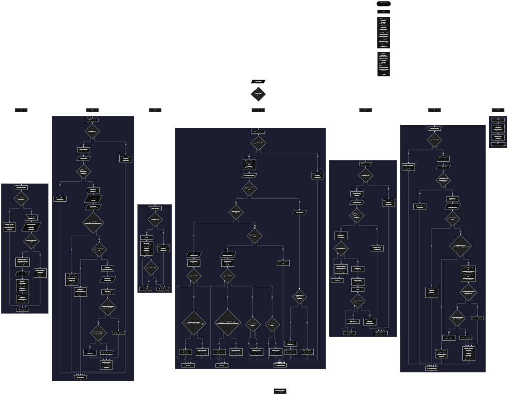

Este proyecto, llamado <b>distribuidor de recursos</b>, fue desarrollado en <b>visual basic .net</b> como un ejercicio práctico para fortalecer la lógica de programación mediante la creación de un sistema de administración y distribución de recursos desde la consola. El programa cuenta con un menú principal de siete opciones que permite <b>registrar, editar, listar, buscar, eliminar y distribuir recursos</b>, además de controlar su disponibilidad. Cada recurso almacena información como el nombre, la cantidad disponible, la cantidad asignada, el responsable y su estado, utilizando arreglos con una capacidad máxima de <b>10 recursos durante la ejecución</b>. Durante su desarrollo se aplicaron conceptos fundamentales de programación, como variables, arreglos, estructuras condicionales, ciclos repetitivos y estructuras de selección, además de procesos para buscar, modificar, eliminar, reorganizar registros y actualizar las cantidades de los recursos. Este proyecto permite poner en práctica los conocimientos adquiridos en Visual Basic .NET y comprender cómo administrar existencias y controlar la distribución de recursos mediante una aplicación de consola.

<h2 align="center">⚙️ Funcionamiento del menú principal</h2>

### ➕ Registrar recurso

La opción <b>1) registrar recurso</b> permite agregar un nuevo recurso al sistema. Antes de realizar el registro, el programa comprueba que la cantidad de recursos almacenados sea menor que la capacidad de los arreglos mediante la condición <b>cantidad &lt; ids.Length</b>. Si existe espacio disponible, asigna un identificador consecutivo utilizando <b>ids(cantidad) = cantidad + 1</b> y solicita el <b>nombre del recurso</b> y su <b>cantidad disponible</b>. Después, comprueba que la cantidad introducida no sea negativa mediante la condición <b>cantidadDisponible &lt; 0</b>. Si el valor es válido, almacena la cantidad disponible, inicializa la cantidad asignada en <b>0</b>, solicita el nombre del responsable y establece el estado inicial como <b>"Disponible"</b>. Finalmente, aumenta la variable <b>cantidad</b> en uno y muestra el mensaje <b>"Recurso registrado correctamente."</b>, junto con la información del recurso registrado. Si la cantidad disponible es negativa, muestra el mensaje <b>"La cantidad disponible no puede ser negativa."</b> e impide completar el registro. Si se alcanza la capacidad máxima, presenta el mensaje <b>"No hay espacio para registrar mas recursos."</b>.

### ✏️ Editar recurso

La opción <b>2) editar recurso</b> permite modificar la información de un recurso registrado. Primero, el programa comprueba si existen registros mediante la variable <b>cantidad</b>. Si no hay recursos almacenados, muestra el mensaje <b>"No existen recursos registrados."</b>. En caso contrario, utiliza un ciclo <b>For</b> para mostrar los identificadores, nombres, cantidades disponibles, cantidades asignadas, responsables y estados de todos los recursos. Después, solicita el ID del recurso que se desea editar y comprueba que esté dentro del rango permitido mediante la condición <b>idEditar &gt;= 1 AndAlso idEditar &lt;= cantidad</b>. Si la selección es válida, calcula la posición correspondiente restando uno al identificador mediante <b>posicion = idEditar - 1</b>. A continuación, solicita el nuevo nombre y la nueva cantidad disponible. El programa comprueba que la nueva cantidad no sea menor que la cantidad que ya se encuentra asignada y que no sea negativa. Si las condiciones se cumplen, actualiza la cantidad disponible, solicita el nuevo responsable y determina el estado del recurso: <b>"Agotado"</b> cuando no quedan unidades disponibles, <b>"Parcial"</b> cuando existen unidades asignadas y todavía quedan unidades disponibles, o <b>"Disponible"</b> cuando no hay unidades asignadas. Finalmente, muestra el mensaje <b>"Recurso actualizado correctamente."</b> y presenta la información actualizada. Si el ID no corresponde a un registro existente, muestra el mensaje <b>"ID no encontrada."</b>.

### 📋 Listar recursos

La opción <b>3) listar recursos</b> permite visualizar todos los recursos registrados actualmente en el sistema. Antes de mostrar la información, el programa comprueba si la variable <b>cantidad</b> es igual a cero. Si no existen registros, presenta el mensaje <b>"No existen recursos registrados."</b>. Si hay recursos disponibles, utiliza un ciclo <b>For</b> para recorrer los arreglos desde la primera posición hasta la última posición ocupada. Durante el recorrido, muestra el <b>ID, nombre del recurso, cantidad disponible, cantidad asignada, responsable y estado</b> de cada registro. Esta función facilita consultar las existencias y conocer la situación actual de los recursos almacenados.

### 🔎 Buscar recurso

La opción <b>4) buscar recurso</b> permite localizar los recursos registrados mediante tres criterios de búsqueda: <b>ID, nombre del recurso y responsable</b>. Primero, el programa comprueba si existen registros. Si no hay recursos almacenados, muestra el mensaje <b>"No existen recursos registrados."</b>. En caso contrario, presenta un submenú para seleccionar el tipo de búsqueda. Cuando se selecciona la búsqueda por <b>ID</b>, solicita el identificador y comprueba que se encuentre dentro del rango de registros existentes. Si es válido, calcula la posición correspondiente mediante <b>posicion = idBuscar - 1</b> y muestra toda la información del recurso. Cuando se selecciona la búsqueda por <b>nombre del recurso</b> o <b>responsable</b>, solicita el texto que se desea localizar, inicializa la variable lógica <b>encontrado</b> con el valor <b>False</b> y utiliza un ciclo <b>For</b> para recorrer los registros. Durante el recorrido, compara los textos mediante <b>ToLower().Contains()</b>, permitiendo encontrar coincidencias parciales sin distinguir entre mayúsculas y minúsculas. Si encuentra coincidencias, muestra la información de cada recurso y cambia la variable <b>encontrado</b> a <b>True</b>. Si finaliza el recorrido sin encontrar resultados, presenta el mensaje <b>"No se encontraron recursos."</b>. Si se introduce una opción que no corresponde a los criterios disponibles, muestra el mensaje <b>"Opcion no valida."</b>.

### 🗑️ Eliminar recurso

La opción <b>5) eliminar recurso</b> permite eliminar un recurso registrado mediante su identificador. Antes de comenzar, el programa comprueba si existen recursos almacenados. Si no hay registros, muestra el mensaje <b>"No existen recursos registrados."</b>. Si existen recursos, utiliza un ciclo <b>For</b> para mostrar la información de todos los registros y solicita el ID del recurso que se desea eliminar. Después, comprueba que el identificador esté dentro del rango válido mediante la condición <b>idEliminar &gt;= 1 AndAlso idEliminar &lt;= cantidad</b>. Si el ID es correcto, calcula la posición correspondiente y comienza el proceso de eliminación. Para mantener los registros organizados, utiliza un ciclo <b>For</b> que desplaza una posición hacia atrás los datos posteriores en los seis arreglos: <b>ids, recursos, cantidadesDisponibles, cantidadesAsignadas, responsables y estados</b>. Posteriormente, disminuye la variable <b>cantidad</b> en uno y limpia la última posición ocupada, asignando valores vacíos o cero según el tipo de dato. Finalmente, utiliza otro ciclo <b>For</b> para reorganizar los identificadores consecutivamente, comenzando desde el número uno. Al terminar, muestra el mensaje <b>"Recurso eliminado correctamente."</b>. Si el ID introducido no corresponde a un recurso registrado, presenta el mensaje <b>"ID no encontrada."</b>.

### 📦 Distribuir recurso

La opción <b>6) distribuir recurso</b> permite asignar una determinada cantidad de unidades de un recurso registrado y actualizar automáticamente sus existencias. Primero, el programa comprueba si existen recursos almacenados. Si no hay registros, muestra el mensaje <b>"No existen recursos registrados."</b>. En caso contrario, presenta una lista con los identificadores, nombres, cantidades disponibles, cantidades asignadas, responsables y estados. Después, solicita el ID del recurso que se desea distribuir y comprueba que se encuentre dentro del rango válido. Si el identificador existe, calcula su posición y solicita la cantidad de unidades que se desean distribuir. A continuación, realiza dos comprobaciones: primero verifica que la cantidad solicitada sea mayor que cero mediante la condición <b>cantidadDistribuir &gt; 0</b> y después comprueba que no supere las unidades disponibles mediante la condición <b>cantidadDistribuir &lt;= cantidadesDisponibles(posicion)</b>. Si alguna condición no se cumple, muestra el mensaje correspondiente e impide realizar la distribución. Si la cantidad es válida, resta las unidades distribuidas de <b>cantidadesDisponibles</b> y las suma a <b>cantidadesAsignadas</b>. Después, actualiza el estado del recurso: establece <b>"Agotado"</b> cuando la cantidad disponible llega a cero, <b>"Parcial"</b> cuando todavía quedan unidades disponibles y existen unidades asignadas, o <b>"Disponible"</b> cuando no hay unidades asignadas. Finalmente, muestra el mensaje <b>"Recurso distribuido correctamente."</b> e informa la cantidad distribuida, las unidades disponibles, las unidades asignadas y el estado actualizado. Si el ID introducido no corresponde a un registro existente, muestra el mensaje <b>"ID no encontrada."</b>.

### 🚪 Salir del menú principal

La opción <b>7) salir</b> permite finalizar la ejecución del programa y muestra el mensaje <b>"Gracias por utilizar Distribuidor de Recursos."</b>. El menú principal se encuentra dentro de una estructura repetitiva <b>Do ... Loop While</b>, que mantiene el programa en funcionamiento mientras la opción seleccionada sea diferente de <b>7</b>. Cuando el usuario selecciona esta opción, se ejecuta el mensaje de despedida y la condición <b>opcion &lt;&gt; 7</b> deja de cumplirse, finalizando el ciclo y la ejecución del programa.

<h2 align="center">🧠 Temas aplicados en el proyecto</h2>

### 📦 Variables

En este proyecto se utilizan variables para controlar las opciones del menú, administrar la cantidad de recursos registrados, recorrer los arreglos, identificar los recursos que se desean editar, buscar, eliminar o distribuir y controlar las cantidades disponibles y asignadas. También se utilizan variables auxiliares para almacenar temporalmente los datos introducidos por el usuario y comprobar las condiciones necesarias antes de realizar cada operación.

🔢 **Opcion:** Almacena la opción seleccionada por el usuario en el menú principal.

📊 **Cantidad:** Controla el número de recursos registrados actualmente.

🔄 **I:** Funciona como contador en los ciclos <b>For</b> y permite recorrer las posiciones de los arreglos.

🆔 **IdEditar:** Almacena el identificador del recurso que se desea modificar.

🆔 **IdBuscar:** Almacena el identificador del recurso que se desea localizar.

🆔 **IdEliminar:** Almacena el identificador del recurso que se desea eliminar.

🆔 **IdDistribuir:** Almacena el identificador del recurso al que se le distribuirán unidades.

📍 **Posicion:** Determina la posición del recurso dentro de los arreglos a partir de su identificador.

📦 **CantidadDisponible:** Almacena temporalmente la cantidad inicial disponible durante el registro de un recurso.

📦 **NuevaCantidad:** Almacena la nueva cantidad disponible introducida durante la edición de un recurso.

📦 **CantidadDistribuir:** Almacena la cantidad de unidades que se desean distribuir.

🔎 **TipoBusqueda:** Identifica el criterio seleccionado en el submenú de búsqueda.

🔍 **RecursoBuscar:** Almacena el nombre del recurso que se desea localizar.

👤 **ResponsableBuscar:** Almacena el responsable que se desea localizar.

✅ **Encontrado:** Variable lógica que indica si se encontraron coincidencias durante las búsquedas por nombre o responsable.

### 🗃️ Arreglos

En este proyecto se utilizan seis arreglos paralelos para almacenar la información de los recursos registrados. Cada arreglo tiene una capacidad de <b>10 posiciones</b> y utiliza el mismo índice para representar los datos correspondientes a un mismo recurso. Por ejemplo, la información del recurso almacenado en la posición <b>0</b> se encuentra distribuida entre <b>ids(0), recursos(0), cantidadesDisponibles(0), cantidadesAsignadas(0), responsables(0) y estados(0)</b>. Esta organización permite administrar los registros de manera relacionada y facilita realizar operaciones de registro, edición, búsqueda, eliminación y distribución.

🆔 **Ids(10):** Almacena los identificadores numéricos de los recursos registrados.

📦 **Recursos(10):** Almacena los nombres de los recursos disponibles en el sistema.

🔢 **CantidadesDisponibles(10):** Almacena las unidades que todavía se encuentran disponibles para distribuir.

📊 **CantidadesAsignadas(10):** Almacena las unidades que ya han sido distribuidas de cada recurso.

👤 **Responsables(10):** Almacena los nombres de las personas responsables de cada recurso.

📋 **Estados(10):** Almacena el estado actual de cada recurso, que puede ser <b>"Disponible"</b>, <b>"Parcial"</b> o <b>"Agotado"</b>.

### 🔀 Estructuras condicionales

En este proyecto se utilizan las estructuras <b>If, ElseIf y Else</b> para controlar las diferentes operaciones del sistema. Estas condiciones permiten comprobar si existe espacio antes de registrar un recurso, verificar que las cantidades introducidas sean válidas, comprobar que la nueva cantidad disponible no sea inferior a las unidades asignadas, validar los identificadores seleccionados y controlar que la cantidad que se desea distribuir no supere las existencias disponibles. También permiten determinar automáticamente el estado de cada recurso según sus cantidades disponibles y asignadas, así como comprobar si se encontraron coincidencias durante las búsquedas.

### 🔄 Estructuras repetitivas

En este proyecto se utilizan las estructuras repetitivas <b>Do ... Loop While</b> y <b>For ... Next</b>. El ciclo <b>Do ... Loop While</b> mantiene activo el menú principal y permite ejecutar diferentes operaciones hasta que el usuario selecciona la opción de salida. Por otro lado, los ciclos <b>For ... Next</b> permiten recorrer los arreglos para mostrar los recursos registrados, realizar búsquedas por nombre y responsable, presentar los registros antes de editarlos o eliminarlos y reorganizar la información después de eliminar un recurso. Estos ciclos facilitan trabajar con los registros sin necesidad de acceder manualmente a cada posición.

### 🎯 Estructura select case

El programa utiliza la estructura <b>Select Case</b> para evaluar el valor almacenado en la variable <b>opcion</b> y ejecutar las instrucciones correspondientes a cada selección del menú principal. Cada caso representa una operación específica del sistema: <b>registrar, editar, listar, buscar, eliminar, distribuir o salir</b>. También se utiliza el bloque <b>Case Else</b> para mostrar el mensaje <b>"Opcion no valida."</b> cuando el usuario introduce un número que no corresponde a ninguna de las opciones definidas.

### 🔢 Dimensionamiento de arreglos

El programa utiliza la declaración de arreglos con la dimensión <b>(9)</b>, lo que establece diez posiciones disponibles para almacenar información, debido a que los índices comienzan desde cero. Esta capacidad se aplica a los seis arreglos del proyecto, permitiendo administrar hasta <b>10 recursos durante la ejecución</b>. La variable <b>cantidad</b> controla cuántos registros se encuentran ocupados y permite que las operaciones trabajen únicamente con las posiciones que contienen información.

### 🔄 Reorganización de registros

Cuando se elimina un recurso, el programa utiliza un ciclo <b>For</b> para desplazar los datos de los registros posteriores una posición hacia atrás en los seis arreglos paralelos. El recorrido comienza en la posición del recurso seleccionado y termina en <b>cantidad - 2</b>. Después, disminuye la variable <b>cantidad</b> en uno y limpia la última posición ocupada, restableciendo los valores de los arreglos. Finalmente, utiliza otro ciclo <b>For</b> para asignar nuevamente los identificadores consecutivos mediante <b>ids(i) = i + 1</b>. Este procedimiento mantiene los registros organizados y evita dejar espacios vacíos entre los recursos almacenados.

### 📊 Control de existencias y estados

El proyecto utiliza las variables <b>cantidadesDisponibles</b> y <b>cantidadesAsignadas</b> para controlar las unidades de cada recurso. Cuando se registra un recurso, la cantidad asignada comienza en cero. Durante una distribución válida, las unidades solicitadas se restan de la cantidad disponible y se suman a la cantidad asignada. Además, el programa actualiza el estado del recurso según las existencias restantes: <b>"Disponible"</b> cuando no existen unidades asignadas, <b>"Parcial"</b> cuando hay unidades asignadas y todavía quedan existencias, y <b>"Agotado"</b> cuando la cantidad disponible llega a cero. Esta lógica también se aplica cuando se modifica la información de un recurso y se actualiza su cantidad disponible.

<h2 align="center">¿Cómo se implementaron las operaciones crud en el proyecto?</h2>

Las operaciones <b>crud</b> se implementaron mediante las opciones del menú principal, permitiendo administrar los recursos registrados. La operación <b>crear</b> corresponde a <b>registrar recurso</b>, donde se introducen los datos de un nuevo recurso y se inicializan sus cantidades y estado; <b>leer</b> se realiza mediante las opciones <b>buscar recurso y listar recursos</b>, que permiten consultar la información almacenada; <b>actualizar</b> corresponde a <b>editar recurso</b>, donde se modifican los datos de un recurso existente; y <b>eliminar</b> se realiza mediante la opción <b>eliminar recurso</b>, que retira un registro y reorganiza los datos de los arreglos. Además, el proyecto incorpora la opción <b>distribuir recurso</b>, que permite controlar las unidades disponibles y asignadas, actualizando automáticamente el estado de cada recurso. Todas estas operaciones trabajan con arreglos paralelos y mantienen la información temporalmente durante la ejecución del programa.

<h2 align="center">Diagrama de flujo del proyecto</h2>

<h2 align="center">🛡️ Validaciones del programa</h2>

### 📭 No existen recursos registrados

Esta validación se utiliza en las opciones de <b>editar, listar, buscar, eliminar y distribuir recursos</b>. El programa comprueba si la variable <b>cantidad</b> es igual a <b>0</b> y, si no existen registros almacenados, muestra el mensaje <b>"No existen recursos registrados."</b>. Esta comprobación evita continuar con operaciones que necesitan información almacenada cuando el sistema se encuentra vacío.

### ⚠️ Capacidad máxima alcanzada

Esta validación se utiliza durante el registro de nuevos recursos para controlar la capacidad máxima de los arreglos. El programa comprueba si <b>cantidad &gt;= ids.Length</b> antes de permitir agregar un nuevo registro. Si todavía existe espacio disponible, solicita los datos del recurso y permite completar el registro cuando las cantidades cumplen las condiciones establecidas. En caso contrario, muestra el mensaje <b>"No hay espacio para registrar mas recursos."</b>, impidiendo almacenar más recursos cuando se alcanza el límite de diez posiciones.

### 🔢 Cantidad disponible no válida

Esta validación se utiliza durante el registro de un recurso para impedir que se almacenen cantidades disponibles negativas. El programa comprueba si <b>cantidadDisponible &lt; 0</b> y, cuando se cumple esta condición, muestra el mensaje <b>"La cantidad disponible no puede ser negativa."</b>. Durante la edición, también comprueba que la nueva cantidad disponible no sea inferior a la cantidad que ya se encuentra asignada y que no sea negativa. Si alguna de estas condiciones se cumple, muestra el mensaje correspondiente e impide actualizar la cantidad disponible.

### ❌ ID no encontrada

Esta validación se utiliza durante las operaciones de <b>editar, buscar por ID, eliminar y distribuir recursos</b>. El programa comprueba que el identificador introducido sea mayor o igual a <b>1</b> y menor o igual al valor de <b>cantidad</b>. Si el ID se encuentra dentro del rango permitido, calcula su posición mediante <b>posicion = id - 1</b> y continúa con la operación correspondiente. Si el identificador no corresponde a un recurso registrado, muestra el mensaje <b>"ID no encontrada."</b>.

### 🔎 Recurso o responsable no encontrado

Esta validación se utiliza durante las búsquedas por nombre del recurso y responsable. El programa inicializa la variable lógica <b>encontrado</b> con el valor <b>False</b> y recorre los registros para comparar los textos almacenados con el valor introducido por el usuario. Cuando encuentra una coincidencia, cambia la variable a <b>True</b> y muestra la información correspondiente. Si termina el recorrido sin encontrar resultados, presenta el mensaje <b>"No se encontraron recursos."</b>. Las comparaciones utilizan <b>ToLower().Contains()</b>, permitiendo localizar coincidencias parciales sin distinguir entre mayúsculas y minúsculas.

### 📦 Cantidad a distribuir no válida

Esta validación se utiliza durante la distribución de recursos para impedir que se asignen cantidades iguales o inferiores a cero. El programa comprueba si <b>cantidadDistribuir &lt;= 0</b> y, cuando se cumple esta condición, muestra el mensaje <b>"La cantidad a distribuir debe ser mayor que cero."</b>. De esta manera, evita realizar distribuciones con cantidades que no representan una asignación válida.

### ⚠️ Existencias insuficientes

Esta validación se utiliza cuando el usuario intenta distribuir más unidades de las que se encuentran disponibles. El programa compara la cantidad solicitada con las existencias almacenadas mediante la condición <b>cantidadDistribuir &gt; cantidadesDisponibles(posicion)</b>. Si la cantidad solicitada supera las unidades disponibles, muestra un mensaje indicando cuántas unidades se intentaron distribuir y cuántas se encuentran disponibles. En este caso, no modifica las cantidades asignadas ni las existencias del recurso.

### 📋 Actualización de estados

El programa comprueba las cantidades disponibles y asignadas para determinar el estado de cada recurso. Si la cantidad disponible es igual a <b>0</b>, establece el estado <b>"Agotado"</b>. Si todavía existen unidades disponibles y la cantidad asignada es mayor que <b>0</b>, establece el estado <b>"Parcial"</b>. Finalmente, si no existen unidades asignadas y todavía hay existencias disponibles, establece el estado <b>"Disponible"</b>. Esta comprobación se ejecuta después de una edición válida o una distribución correcta, manteniendo actualizado el estado de acuerdo con las cantidades del recurso.

### ⚠️ Opción inválida

La estructura <b>Select Case</b> incluye el bloque <b>Case Else</b>, que muestra el mensaje <b>"Opcion no valida."</b> cuando el usuario introduce un número que no corresponde a ninguna de las siete opciones definidas en el menú principal. De esta manera, el programa informa cuando se selecciona una opción que no está disponible.

### ⚠️ Entrada de datos numéricos

El programa utiliza <b>Convert.ToInt32(Console.ReadLine())</b> para convertir las entradas del usuario en valores numéricos enteros, como las opciones del menú, los identificadores y las cantidades de los recursos. Sin embargo, no cuenta con una validación para controlar entradas que contengan letras, texto u otros valores que no puedan convertirse a números enteros. En esos casos, la conversión puede generar una excepción e interrumpir la ejecución del programa.

<h2 align="center">🎯 Objetivo del proyecto</h2>

El objetivo principal de este proyecto es fortalecer la <b>lógica de programación</b> mediante el desarrollo de un sistema de administración y distribución de recursos en <b>visual basic .net</b>. A través de su construcción se busca aplicar los conocimientos adquiridos sobre variables, arreglos, estructuras condicionales, ciclos repetitivos y estructuras de selección, integrándolos para resolver un problema de manera organizada. Además, el proyecto permite comprender cómo registrar, consultar, modificar y eliminar información, así como controlar existencias, asignar cantidades y actualizar estados mediante una aplicación de consola, estableciendo una base para desarrollar sistemas de gestión más completos con otros lenguajes y tecnologías.

